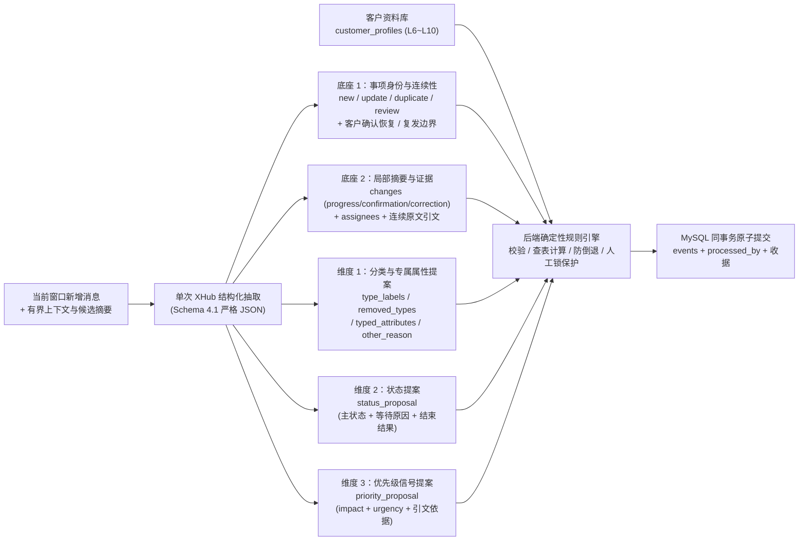

# 分类、状态与优先级增量开发方案

日期：2026-11-18。状态：方案定稿待确认，尚未修改业务代码或现存数据库。

本方案将队友 PR #9 中经过验证的「多标签分类与类型专属属性规范」吸收到主干增量链路，并与「事件生命周期状态」「事件业务优先级」合并为一套**单窗口、单次模型调用、后端确定性规则落库**的统一增量更新方案。其余工程约束继续遵循 [项目简报](项目简报.md)、[工程架构](工程架构.md) 与 [多客户接入与定时增量开发方案](多客户接入与定时增量开发方案.md)。

> **口径声明**：官方硬性下限仍为商机、流失、排障、资源需求、功能需求、商务需求六类事件及公共属性、可核对证据。下文定义的多标签补充规则、五态主状态、等待原因、结束结果、优先级 `P0～P3` 档位与 `Impact × Urgency` 查表矩阵、超级大客加权规则，均为**本项目本地工程口径与集中可配置缺省**，不冒充已公布的官方评分枚举；持久化时保留兼容字段与历史原文映射。

---

## 一、术语解耦（消除“待确认”重名冲突）

现有代码与调研草稿中多处共用「待确认」一词，同屏展示时难以区分“指代有疑点需人工复核”与“仅缺少进展信息”。本方案将四类未定语义彻底拆开：

| 所属层次 | 标准用词 | 对应字段 | 精确业务含义 |
| --- | --- | --- | --- |
| 分类层 | **待分类** | `type="待分类"` / `classification_status="待分类"` | 事项本身有明确依据成立，但现有证据尚不足以归入六类，也不足以排除六类 |
| 状态层 | **状态未明** | `status="状态未明"` | 事项成立，但当前聊天片段无足够证据判断跟进阶段，或由历史旧数据 `"未知"` 映射而来；不进入待处理队列 |
| 优先级层 | **待评估** | `priority="待评估"` | 尚无足够影响或紧迫度证据，或历史旧记录尚未评估；不假装紧急，也不伪装已评为低优 |
| 归属与冲突复核层 | **待核对**（兼容归属 `review`） | `decision="review"` / `review_flag` / `review_items` | 聊天指代不清无法确定归属，或前后事实、人工锁定与新证据发生冲突，需人工核对 |
| 客户准入层（既有） | **等级待确认 / 群待确认** | `customer_segment="pending"` | 缺少客户 UID 或月销等级未成功刷新，暂不自动纳入大客分析 |

---

## 二、增量更新总体架构：「2 个底座 + 3 个业务维度」

单客户单窗口执行（`IncrementalService.run_window`）保持**一次模型请求完成全部提取与提案**，不在同一窗口拆成多次模型调用，避免跨维度语义矛盾和三倍调用开销。整体职责切分为两层既有底座与三个结构化业务维度：

核心工程分工原则：

1. **模型只负责理解文本并给出带引文的提案**：模型从本轮新增消息提取客观事实、多标签依据、专属属性原话、状态提案及影响/紧迫度信号，每项必须绑定本轮 `evidence_ids` 与连续原文 `quote`。
2. **后端确定性规则负责拍板最终业务值**：类型字典核验、多标签完成标准、重开与复发边界、`Impact × Urgency + 客户等级` 优先级计算、迟到消息防倒退、人工锁定保护全部由 Python 纯逻辑执行。
3. **不引入全字段多槽位状态机**：放弃 PR #9 Schema 5.0 的 `field_updates` / `field_states` 全量入模方案，避免提示词自相矛盾和 `HistoryRetriever` 上下文体积爆炸。

---

## 三、维度一：分类与类型专属属性（吸收 PR #9 精华）

### 3.1 多标签、其他与待分类规则

- **允许标签集合**：官方六类（`商机`、`流失`、`排障`、`资源需求`、`功能需求`、`商务需求`）加补充标签 `其他`（`EVENT_LABELS`）；无确认标签但事项已成立时主类型记为 `待分类`（`PENDING_TYPE`）。
- **多标签共存与分片边界**：
  - 同一可追踪目标同时具备多种有证据的业务性质时，允许在同一 `event_id` 上挂多个标签（例如“明确为采购 B 服务申请一年方案报价”同时具备 `商机` + `商务需求`；“本次故障再不恢复就迁走业务”同时具备 `排障` + `流失`）。
  - 同一条消息中对象不同、目标不同或可独立验收的不同诉求，必须拆分为多个候选事项，不得堆砌多标签掩盖多个独立事项。
  - `Event.types: list[str]` 保存完整当前标签；`Event.type: str` 保留为主标签（兼容现有 `events.type` 列与旧调用方，必须包含在 `types` 中；`待分类` 时 `types=[]`）。
- **`其他` 与 `待分类` 的严格边界**：
  - `其他`：仅在事项真实成立（有现实业务对象和明确答复、核验或服务交付责任，如既有产品专项培训、上线前书面适用性评估），且有直接证据说明为何排除六类时使用，必填 `other_reason: Fact`。
  - `待分类`：事项已可定位但现有证据无法确认属于哪一类，也无法排除六类时使用；禁止用 `其他` 兜底证据不足。
- **跨轮演进与撤销**：
  - 放开 `contract.py`、`attribution.py`、`matching.py` 中“更新目标必须与候选主类型完全相同”的旧限制；跨群、跨天、换人跟进或标签增减均保持同一 `event_id`。
  - 本轮未重提的旧标签默认保留；仅当本轮原文明确更正先前误述时，才允许通过 `removed_types`（附本轮更正引文）移除对应标签及其专属属性，并保留撤销审计记录。

### 3.2 六类界定与专属属性字典

完整吸收队友整理的六类最低证据门槛、易混成对边界（试用≠购买、报价≠成交、抱怨≠流失、内部扩容处置≠客户资源申请、恢复既有预期属排障、改善现有功能表现可属功能需求、付款陈述≠到账核实）及标准属性名（`TYPE_ATTRIBUTE_NAMES`）：

| 类型标签 | 允许提取的专属属性名（按已知直接证据选填，缺失不猜） |
| --- | --- |
| 商机 | 交易对象与采购范围、采购意向与评估事实、计划规模、预算或交易金额、采购/上线计划时间、成交事实及范围 |
| 流失 | 流失对象与范围、风险、计划与实际变化、原因与触发条件、减少或转移规模、去向与执行时间、挽留或退出办理结果 |
| 排障 | 异常对象与环境、症状与对照表现、客户影响、发生及影响范围、排查发现与根因、处置与验证结果、恢复事实 |
| 资源需求 | 资源对象与交付范围、请求动作与用途、现有可用量、目标总量与增减量、资源缺口、期望交付与承诺、审批、交付与可用验证 |
| 功能需求 | 能力对象与使用场景、当前行为及限制、期望行为与改善目标、验收条件、期望可用时间、评估与承诺范围、上线与需求验证结果 |
| 商务需求 | 办理对象与事项范围、价格与金额口径、合同与商务条件、续费或终止安排、账单与发票要求、办理期限与约定、办理事实与结果 |

- **逐字保真约束**：`typed_attributes` 每项包含 `{type_label, name, value, evidence_ids, quote}`，继续执行 `quote in content` 且 `value in quote` 的逐字子串校验，防止模型编造数值、单位、币种、日期或根因。
- **冲突保守处理**：同批或跨轮对同一属性若出现未明确声明更正的不同值（排除「审批、交付与可用验证」「上线与需求验证结果」「处置与验证结果」等正常阶段推进字段），保留原采用值并将冲突字段记入待核对提示。
- **扁平兼容投影**：有效 `typed_attributes` 同步投影至 `Event.attributes`；历史单类型事件通过 `normalize_classification()` 在读取时无损补齐缺省分类结构。

---

## 四、维度二：事件生命周期状态（统一主状态 + 等待原因 + 结束结果）

### 4.1 三层状态结构

将现有自由文本 `status` 升级为可筛选、可校验流转的结构化状态，同时与客户恢复事实 `recovery` 解耦：

| 字段 | 取值范围（本地可配置标准值） | 约束说明 |
| --- | --- | --- |
| 主状态 `status` | `状态未明` / `跟进中` / `等待中` / `已解决` / `已取消` | 必填；缺进展证据或旧 `"未知"` 数据映射为 `状态未明` |
| 等待原因 `waiting_reason` | `等待客户` / `等待内部支撑` / `等待其他方` / `null` | **仅当 `status == "等待中"` 时必填**，其余主状态下必须为 `null` |
| 结束结果 `resolution` | `客户确认恢复` / `支撑声明已修复` / `已答复或已交付` / `已拒绝` / `已撤回` / `确认不成立` / `null` | **仅当 `status in {"已解决", "已取消"}` 时必填**，其余主状态下必须为 `null` |
| 恢复事实 `recovery` | 沿用现有结构或 `null` | **仅限已确认客户账号明确表示恢复时写入**；支撑声明修复或监控恢复不写 `recovery` |

主状态判定口径：

1. **`状态未明`**：仅在残缺历史背景或旧数据无法判断进展时使用；一旦聊天中有明确提出的未结故障、诉求或待办动作，即可进入 `跟进中` 或 `等待中`。
2. **`跟进中`**：事项已成立且需要处理或正在推进，当前未明确卡在特定方等待动作（首版不做人工派单坐席拆分）。
3. **`等待中`**：当前推进明确阻塞于某一方提供信息、执行操作、审批或验证回复（区分 `等待客户`、`等待内部支撑`、`等待其他方`）。
4. **`已解决`**：当前事项所有有效标签下的约定目标均已达成，结果取 `客户确认恢复`、`支撑声明已修复` 或 `已答复或已交付`。**首版不设自动锁单的 `已关闭` 状态**，允许被后续“实际未好”反馈直接重开。
5. **`已取消`**：事项不再继续办理，结果取 `已拒绝`（明确不予支持/办理）、`已撤回`（提出方主动取消）或 `确认不成立`（核实为误报或对象不存在）。

### 4.2 按类型与多标签的完成标准校验

- **排障**：
  - 已确认客户账号明确反馈恢复 -> `已解决` + `客户确认恢复`，并写入 `recovery`。
  - 仅内部支持人员或监控消息声明已修复/已恢复（客户在内部群缺席或未表态） -> 允许进入 `已解决` + **`支撑声明已修复`**，**不写 `recovery`**。若模型提案 `客户确认恢复` 但证据发送者不是已确认客户账号，程序自动降级为 `支撑声明已修复`（内部账号）或转待核对，绝不冒充客户验收。
- **资源需求 / 功能需求 / 商务需求 / 其他**：
  - 有明确证据表明资源已交付（或按约定完成排期答复）、功能已上线交付（或咨询型诉求已给出明确结论答复）、商务账单/报价/合同/开票事务已办结、专项服务已完成 -> `已解决` + `已答复或已交付`。
  - 明确被拒绝 -> `已取消` + `已拒绝`；明确放弃或取消申请 -> `已取消` + `已撤回`。
- **商机 / 流失**：
  - 商机已明确成交签约、完成转交结论或明确结束本轮跟进 -> `已解决` + `已答复或已交付`（放弃采购记 `已取消` + `已撤回`；一句采购兴趣或发出报价不等于完结）。
  - 流失风险已明确解除（确认续约、放弃迁离）或已完成退出交接办理 -> `已解决` + `已答复或已交付`。
- **多标签“最慢未完责任”原则**：多标签事项只有当**全部当前有效标签**对应的目标均达成时才可进入 `已解决`；若其中任一标签仍有未完责任（如配额已开但报价未出），主状态必须保持 `跟进中` 或 `等待中`。
- **`待分类` 限制**：`classification_status == "待分类"` 的事项不允许进入 `已解决`（仅可处于 `状态未明 / 跟进中 / 等待中`，或明确撤回/误报进入 `已取消`）。
- **禁止隐式关单**：单纯“收到 / 谢谢 / 辛苦了”或数日无人发言绝不触发 `已解决`，不设置凭空的自动关单天数。

### 4.3 重开（Reopen）与复发（Recurrence）的明确分界

1. **重开原事件（同一 `event_id`）**：
   - 事项处于 `已解决`（尤其是 `支撑声明已修复`），但尚无客户 `recovery` 记录，随后收到“还是失败 / 没修好” -> 走 `decision="update"`，主状态重开为 `跟进中`，清空 `resolution`，保留历史修订。
   - 曾有 `recovery` 记录，但客户明确更正“之前测错环境，这次故障一直没好” -> 走 `decision="update"` + `continuity.kind="retract_recovery"`，撤销 `recovery` 并重开为 `跟进中`。
   - **配置约束**：`Settings.closed_statuses` 默认保持空元组 `()`，确保 `已解决` 事件在 `continuity.py` 中不被当作不可重开的终态拦截。
2. **真复发新建关联事件（新 `event_id`）**：
   - 仅当原事件已有可信 `recovery` 记录，且新消息明确表明恢复之后再次发生同类问题 -> 走 `decision="new"` + `continuity.kind="recurrence"`，创建新事件并记录 `recurrence_of`。

---

## 五、维度三：事件业务优先级（基础评估 + 客户等级确定性加权）

### 5.1 概念隔离与职责边界

严格区分四个维度：**客观业务影响（`impact`）**、**时间紧迫度（`urgency`）**、**客户月销等级（`L0～L10`）**、**最终业务优先级（`priority`）**。

- 模型**只提取**聊天证据支撑的 `impact` 与 `urgency` 提案（不读客户等级，不直接拍板最终优先级，不凭“尽快”字眼无依据跳最高档）。
- 后端读取 `customer_profiles` 并调用现有 `domain/customer_policy.py` 的 `is_super_large(level, level_state)`，按确定性矩阵算出 `base_priority` 与最终 `priority`。
- 事件优先级**与生命周期状态独立**（进入 `等待中`、`已解决`、`已取消` 不自动降级优先级），且**仅用于业务展示、筛选与列表排序**，不抢占后台 `ANALYSIS_SLOTS` 分析 worker 名额。

### 5.2 影响与紧迫度取证锚点（结合六类专属属性）

| 信号维度 | 档位取值 | 结合分类属性的聊天取证标准 |
| --- | --- | --- |
| **业务影响 `impact`** | `critical` | 生产核心业务中断、大面积失败不可用、已发生或高度疑似的数据丢失/泄露/资损/重大安全风险 |
|  | `high` | 核心功能严重受阻且无可用绕行方案；客户明确已开始执行减量/迁离或大额核心合作面临直接终止 |
|  | `medium` | 局部异常或性能退化（有绕行或范围有限）；明确的条件性流失警告；阻塞既定上线/活动/合同节点的需求或商务事项 |
|  | `low` | 常规配额调整、一般功能体验改善建议、日常询价/对账/开票/续费手续、技术核验咨询或专项培训 |
|  | `unknown` | 原文仅有残缺指代或背景，无法判断影响程度 |
| **紧迫度 `urgency`** | `immediate` | 线上异常正在持续发生并造成即时业务受损，或已触及/处于当日截止期限（如今日上线、活动进行中、账期当日到期） |
|  | `soon` | 原文明确给出近期目标期限或承诺节点（如本周内交付、指定近期日期前需办妥） |
|  | `normal` | 常规排期、远期规划，或未给出明确紧迫期限 |
|  | `unknown` | 原文未提及任何时间或紧迫性线索 |

多标签事项存在多个信号时，按其中最高的影响与紧迫度评估。

### 5.3 基础优先级查表矩阵与缺省规则

集中配置于 `domain/priority_policy.py`（支持后续按业务反馈调整，不散落硬编码）：

- 当 `impact == "unknown"` 时：`base_priority = "待评估"`（即使只有一句无上下文的“请尽快处理”，因对象与影响不明，不盲目定级）。
- 当 `impact` 已明确但 `urgency == "unknown"`（聊天未单独提期限）时：`critical` 默认按 `immediate` 起评，其余已确认影响按 `normal` 查表：

| `impact` \ `urgency` | `immediate` | `soon` | `normal`（及非 critical 未提期限缺省） |
| --- | --- | --- | --- |
| **`critical`** | `P0` | `P0` | `P0` |
| **`high`** | `P0` | `P1` | `P1` |
| **`medium`** | `P1` | `P2` | `P2` |
| **`low`** | `P2` | `P2` | `P3` |

### 5.4 L9 / L10 超级大客确定性提档与同档排序规则

1. **提档上限保护（不压过真实 `P0` 事故）**：
   - 当客户资料 `is_super_large(level, level_state)` 为真（`level_state == "fresh"` 且 `level in {"L9", "L10"}`）时：
     - `base_priority == "P3"` -> 提升一档为 **`P2`**；
     - `base_priority == "P2"` -> 提升一档为 **`P1`**；
     - `base_priority in {"P1", "P0", "待评估"}` -> **保持原档位不变**（禁止仅凭超级大客身份升入 `P0`，确保 `P0` 严格留给真实生产中断/数据风险或即时高影响事件；`待评估` 不无依据升档）。
   - 当客户等级为 `L6～L8` 时：`priority = base_priority`。
   - 当客户等级状态为 `pending`（未知/查询失败/过期）时：`priority = base_priority`，并在 `priority_detail.level_note` 明确标注 `"客户等级待确认，暂按基础优先级展示"`，不静默当作低等级。
2. **同档次键优先**：
   - 事件列表排序采用复合键：`(是否未结束 DESC, priority_rank ASC, is_super_large DESC, customer_level_num DESC, end_time DESC)`。因此同为 `P1` 的事项中，`L10 / L9` 自动排在 `L6～L8` 之前。
3. **重评条件与可解释留痕**：
   - 仅当本轮新增消息带来有效的 `priority_proposal` 新依据，或人工触发重算时才更新优先级；沉默、普通催问、状态变更为 `等待中/已解决` 不自动降级。
   - `Event.priority_detail` 完整记录 `{priority, base_priority, impact, urgency, vip_boosted, customer_level, reason, evidence_refs}`，页面同时展示最终优先级、基础优先级与提档说明。`Event.severity` 保留兼容（新事件同步写入 `priority` 字符串，旧事件自由文本保留于 `legacy_severity`）。

---

## 六、轻量人工覆盖与锁定（管控核心管理字段，零 Prompt 膨胀）

针对状态和优先级方案共同要求的「人工可覆盖、可锁定、冲突可见且不阻塞自动流」，采用**仅面向 4 个头部管理字段的轻量锁机制**，不引入全属性槽位表：

- **受控字段范围**：`types`（分类标签）、`status`（含 `waiting_reason` / `resolution`）、`priority`、`assignees`。
- **存储结构**：在 `Event` payload 中维护 `manual_controls: dict[str, ManualControl]`（记录 `locked: bool`、`operator`、`reason`、`decided_at`、`adopted_value`、`pending_conflict`）及递增乐观版本号 `version: int`。
- **自动增量与人工锁协同规则**：
  1. **不向模型暴露人工锁**：模型输入不包含 `manual_controls` 历史，保持客观读取当前聊天。
  2. **未锁定时**：后端按确定性规则正常更新字段。
  3. **已锁定时**：若本轮模型经规则计算出的新值与锁定值一致，仅追加确认依据；若不一致，**保持当前人工锁定值不变**，将本轮模型计算出的候选值与引文写入 `manual_controls[field].pending_conflict`，并在 `review_items` / `review_flag` 标记待核对。同一窗口的摘要和其他未锁定字段照常更新。
  4. **并发与审计**：人工修改接口使用客户事务锁 `store.transaction(uid)` + `expected_version`（过期返回 `409`）+ `operation_id` 幂等键；写入 `updated_by` 时标 `source="manual"`，同时对齐 `executions.py` 与 `execution_changes.py` 的快照指纹过滤逻辑。

---

## 七、统一输出合约与持久化兼容设计

### 7.1 候选输出合约要点（破除枚举与逐字摘录的耦合）

现有 `contract.py` 要求所有 `Fact` 满足 `fact.value in fact.quote`。本方案按字段性质拆分为两类校验：

1. **原文事实类（严格校验 `quote in content` 且 `value in quote`）**：
   - `typed_attributes`、`attributes`、`extensions`、`other_reason`、`assignees`（自领允许 `sender_id`）。
2. **标准化归纳提案类（严格校验 `evidence_ids` 来自本轮且 `quote in content`，校验枚举合法性，不再要求枚举字面量出现在聊天原话中）**：
   - `type_labels: list[TypeLabel]`、`removed_types: list[RemovedTypeLabel]`
   - `status_proposal: StatusProposal | None`（含 `status`、`waiting_reason`、`resolution`、`reason`、`evidence_ids`、`quote`；本轮无新状态依据时为 `null`）
   - `priority_proposal: PriorityProposal | None`（含 `impact`、`urgency`、`reason`、`evidence_ids`、`quote`；本轮无新影响/紧迫度依据时为 `null`）

XHub 调用统一使用递归补齐 `required` 的 `strict_schema()`，确保 `ExtractionOutput` 与正式归属 `AttributionOutput` 在 `json_schema` `strict: true` 模式下完全一致；`xhub_identity` 与实例 `schema_hash` 统一基于转换后的严格 Schema 计算。

### 7.2 历史检索预算与数据库兼容

1. **守住 `HistoryRetriever` 12KB 预算**：`HistoryCandidate.to_input()` 仅输出 `event_id`、`type`、`types`、`classification_status`、`topic_key`、起止时间、`summary`、`status`、`waiting_reason`、`resolution`、`priority`、`assignees`、简要 `attributes` 键值及 `recovery` 引用，**不携带 `type_evidence` 引文列表、完整历史修订或人工控制明细**，防止单事件撑爆 `max_chars=12000` 导致漏检候选。
2. **不改现有业务表列，治理 `VARCHAR(128)` 长度风险**：
   - 继续复用 `events.payload` JSON，无需在现有业务库上执行破坏性 DDL。
   - 完整待核对条目保存在 `payload.review_items: list[dict]`；写入表列 `events.review_flag`（`VARCHAR(128)`）与 `events.status`（`VARCHAR(128)`）前统一做分段去重与 `<= 120` 字符安全截断（如 `"字段冲突待核对等 3 项"`）。
3. **存量旧事件无损兼容**：
   - `Event.from_dict()` 自动执行兼容归一：无 `types` 时从 `type` 补齐；旧 `status == "未知"` 或空串映射为 `状态未明`（其他历史自由文本保存在 `legacy_status` 并保守展示为 `状态未明`）；旧 `severity == "未知"` 映射为 `priority = "待评估"`（非未知历史值保存在 `legacy_severity`）。不伪造完成时间或历史逐标签引文（`classification_evidence_status = "未记录"`）。
4. **一次性切换 `analysis_stream`**：
   - 提示词与输出 Schema 合并定型后一次性生成新的 `configured_stream()`，避免分三次改提示词导致同一批大客户反复切流重洗。

---

## 八、分阶段实施与验证计划

按模块边界分四步推进，每步独立可测：

1. **阶段一：领域模型与纯规则引擎（`domain/` + `analysis/` 单测）**
   - 落地分类字典与兼容归一（`domain/models.py`）、三层状态流转与多标签完成校验（`domain/status_policy.py`）、`Impact × Urgency + L9/L10` 优先级计算器（`domain/priority_policy.py`）、4 字段轻量人工锁合并逻辑。
   - 用合成数据覆盖六类 + `其他` + `待分类`、多标签未完不关单、支撑修复后未好重开、客户确认恢复后真复发、`L9/L10` 提档封顶 `P1`、等级 `pending` 保守展示、迟到补证不倒退、`review_flag` 长度截断。
2. **阶段二：统一提示词、合约校验与增量服务集成（`prompts/` + `contract.py` + `attribution.py` + `updates.py` + `services/`）**
   - 合入精简无矛盾的新版 `event_extraction_v1.txt` 与统一归属合约（含 `strict_schema`、证据保留修复、历史检索轻量输入、读取客户资料计算优先级）。
   - 跑通后端离线全量测试及隔离 MySQL 事务测试；随后在本地对授权样例客户 `1383603926` 执行小窗口真实 XHub 验证，核对模型遵循率、引文准确率与单窗耗时。
3. **阶段三：轻量人工覆盖/锁定接口与查询适配（`services/` + `api/`）**
   - 在 `QueryService` 与事件路由补齐多标签筛选、状态/优先级筛选排序，以及针对 `types / status / priority / assignees` 的人工裁定与解锁接口（含版本并发控制与 `executions` 收据指纹兼容）。
   - 运行 `scripts/export_openapi.py` 与 `npm --prefix web run openapi` 同步契约与生成客户端。
4. **阶段四：前端展示与交互（`web/`）**
   - 列表页支持多标签展示、状态（含等待原因/结果）与优先级（`P0～P3` / 超大客提档标记）展示筛选；详情栏接入精简版 `ClassificationDetails`（多标签依据、专属属性、其他理由、已撤销标签）、状态与优先级依据说明及轻量人工调整入口；补齐 `EventType.tsx` 对 `其他`、`待分类` 的样式支持。
   - 完成 `npm run lint`、`npm run build` 及连接本地真实后端的联调验证。
