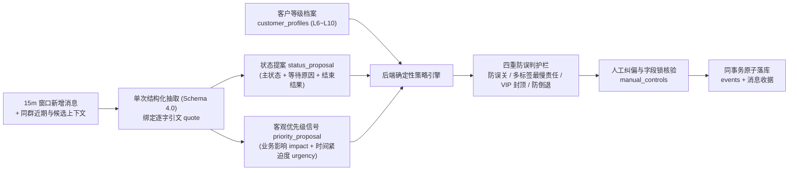
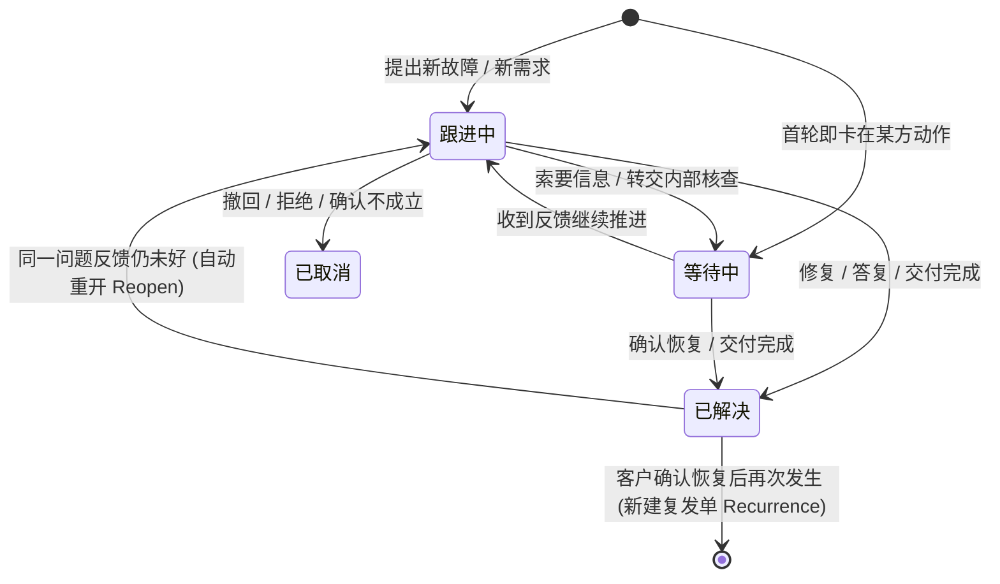

# 事件生命周期状态与业务优先级机制汇报说明

日期：2026-11-18  
适用场景：阶段性架构与实测效果汇报（覆盖统一增量抽取、生命周期状态机、两阶段业务优先级计算、人机协同锁定及 60 大客实测数据）。

> **口径说明**：商机、流失、排障、资源需求、功能需求、商务需求六类主事件及可核对证据为硬性业务下限；下文的状态三层枚举、`Impact × Urgency` 优先级查表矩阵及超大客加权封顶规则，均为本项目集中可配置的本地工程口径，持久化时完整保留证据引文与推理依据。

---

## 一、总体设计原则：「模型提客观信号，规则引擎确定拍板」

在 15 分钟增量窗口管线中，不将同一窗口拆成多次模型调用，也不让大模型直接自由输出 `"高优"` 或 `"已处理完"` 等不可控文本，而是采用**单次结构化抽取 + 后端确定性规则计算**的分工架构：

**三大核心收益**：
1. **杜绝模型主观幻觉与越权判断**：模型看不到也不猜测客户等级，只从聊天原文提取可核验的客观影响与进展引文；最终状态与 `P0~P3` 档位全部由 Python 纯规则确定性算出。
2. **全链路可解释、可追溯**：工作台每个状态徽标与优先级徽标展开后，都能直接看到「客观影响 + 紧迫度 → 基础档位 → 客户等级加权 → 原文消息定位」。
3. **零额外调用成本**：分类、专属属性、生命周期状态、优先级信号在单窗口同一次模型调用内一并产出。

---

## 二、事件生命周期状态体系（解决“在哪一步、卡在谁、怎么完结”）

### 2.1 三层结构化状态定义

将原本不可筛选的自由文本状态升级为**「5 类主状态 × 3 类等待原因 × 6 类结束结果」**三层正交结构：

| 主状态 (`lifecycle_status`) | 子字段约束 | 允许枚举值 | 业务含义与队列行为 |
| :--- | :--- | :--- | :--- |
| **`跟进中`** | 无子字段 | — | 事项已提出或正在排查、沟通、办理推进中（默认活跃主队列） |
| **`等待中`** | 必填 `waiting_reason` | `等待客户` `等待内部支撑` `等待其他方` | 明确卡在特定方动作（如等客户补日志/确认方案、等研发核查、等第三方运营商），便于售后催办分流 |
| **`已解决`** | 必填 `resolution` | `客户确认恢复` `支撑声明已修复` `已答复或已交付` | 事项正常完结，严格区分**客户本人验收恢复**与**内部单方声明修复**（退出待办主队列，沉底展示） |
| **`已取消`** | 必填 `resolution` | `已拒绝` `已撤回` `确认不成立` | 需求明确不予支持、客户主动撤回申请，或核实系误报/非本司问题（退出待办主队列） |
| **`状态未明`** | 无子字段 | — | 残缺片段暂无足够阶段线索，或存量历史自由文本无损映射兜底 |

### 2.2 状态流转与四大确定性防误关护栏

为了防止售后场景中最致命的**「假关单 / 漏跟进」**，后端规则引擎强制执行 **4 条硬护栏**：

1. **排障双轨完结护栏（「支撑声明已修复」≠「客户确认恢复」）**
   - 若仅内部工程师、客服或监控机器人称“已修复/已切流”，没有已核实的客户人工账号（`role="customer"` 且非 `bot`）明确确认恢复，系统**强制归口为 `已解决 · 支撑声明已修复`**，绝不写入客户恢复确认记录。
   - **重开 vs 复发分水岭**：处于 `支撑声明已修复` 时若客户后续反馈“还是报错”，系统自动 `update` **重开原事件回 `跟进中`**；只有已获 **`客户确认恢复`** 后隔段时间再次故障，才作为新一轮独立复发事件新建并关联前序单。
2. **多标签「最慢未完责任」护栏**
   - 同一事件若挂有多个标签（如 `排障 + 资源需求` 或 `资源需求 + 商务需求`），仅完成其中一项（如临时扩容已交付，但故障根因或商务合同未完）时，系统自动拦截 `已解决` 提案，**保持整体为 `跟进中`**，直至全部有效标签完结。
3. **`待分类` 禁入 `已解决` 护栏**
   - 当事项尚处于 `待分类`（缺少明确业务类型及对应验收标准）时，禁止直接判为 `已解决`，自动回退至 `跟进中` 并挂出待核对提示。
4. **乱序/迟到消息防倒退护栏**
   - 若因回溯补采读入发送时间早于当前最新进展的旧消息，旧消息只补充历史证据，**绝不将已推进到 `已解决` 的状态倒退回早期阶段**。

---

## 三、业务优先级评估体系（两阶段计算 + 超大客封顶保护）

优先级拆分为**「第一阶段：客观事实定基础档」**与**「第二阶段：客户目录等级加权」**，既反映问题本身轻重缓急，又体现大客服务分级。

### 3.1 第一阶段：客观 `Impact × Urgency` 二维查表矩阵

模型仅根据聊天原文评估客观**业务影响度（`impact`）**与**时间紧迫度（`urgency`）**，查表得出不含身份偏见的**基础优先级（`base_priority`）**：

| 业务影响 `impact` \ 时间紧迫度 `urgency` | `immediate` （线上持续受损 / 当日死线） | `soon` （明确近期节点 / 当班尽快定位） | `normal` （常规排查 / 常规排期） | `unknown` （原文未提期限线索） |
| :--- | :---: | :---: | :---: | :---: |
| **`critical`**（核心生产中断 / 大面积不可用 / 数据丢失安全资损） | **`P0`** | **`P0`** | **`P0`** | **`P0`** |
| **`high`**（核心功能严重受阻无绕行 / 明确执行迁离或终止合作） | **`P0`** | **`P1`** | **`P1`** | **`P1`** |
| **`medium`**（局部异常或批量报错 / 条件性流失警告 / 阻塞既定上线节点） | **`P1`** | **`P2`** | **`P2`** | **`P2`** |
| **`low`**（少量请求核查 / 常规配置与资源调整 / 功能改善 / 日常商务开票） | **`P2`** | **`P2`** | **`P3`** | **`P3`** |
| **`unknown`**（残缺片段完全无法判断具体问题） | `待评估` | `待评估` | `待评估` | `待评估` |

> **防虚高约束**：客户口头单句催促“尽快帮忙看下”若无客观生产中断依据，只影响紧迫度，不得拉高 `impact` 冲入 `P0`。

### 3.2 第二阶段：`L6~L10` 客户分层加权与 `P1` 封顶规则

后端读取本地客户目录（`customer_profiles`）中已确认有效（`level_state="fresh"`）的月销等级，执行确定性加权：

| 客户分层 | 适用等级 | 加权转换规则（`base_priority → priority`） | 设计考量 |
| :--- | :---: | :--- | :--- |
| **超级大客** | **`L9`、`L10`**（`fresh`） | - `P3 → P2`（提升 1 档，`vip_boosted=true`） - `P2 → P1`（提升 1 档，`vip_boosted=true`） - **`P1 → P1`（封顶保持 `P1`）** - `P0 → P0`、`待评估 → 待评估` | 保障 `L9/L10` 常规诉求优先响应，同时**严禁仅凭大客身份把普通问题顶入 `P0`**，确保 `P0` 永远代表真实生产级重大故障 |
| **普通大客** | **`L6`、`L7`、`L8`**（`fresh`） | 保持客观基础优先级（`P3→P3`、`P2→P2`、`P1→P1`、`P0→P0`） | 完全按客观故障与业务紧迫度排定先后 |
| **等级未知/过期** | `unknown` / `stale` | 暂按基础优先级展示，并在详情标注 `客户等级待确认` | 不按字符串字典序误判（已做数值解析 `10 > 9 > 6`），不盲目提档或降权 |

### 3.3 工作台默认五级复合排序

事件列表默认按「先救火、后大客、已完结沉底」的五级复合键排序：
1. **未完结优先**：`跟进中 / 等待中 / 状态未明` 排在最前，`已解决 / 已取消` 自动沉底；
2. **最终优先级档位**：`P0 → P1 → P2 → P3 → 待评估`；
3. **同档位超级大客优先**：同为 `P1` 时，`L9/L10` 排在普通大客前；
4. **同档位客户等级数值倒序**：`L10 > L9 > L8 > L7 > L6`；
5. **最新消息时间倒序**：最近有新动态的事项排在前面。

---

## 四、人机协同闭环：人工纠偏与字段级锁定

针对售后主管或 TAM 人工研判与模型不一致的场景，工作台提供轻量人工决策闭环：
- **三字段独立纠偏与加锁**：支持对 **分类标签**、**生命周期状态**、**业务优先级** 分别手动修正并勾选「锁定（Lock）」，强制填写简短纠偏原因留痕。
- **增量窗口不覆盖人工锁**：加锁后，后续 15 分钟增量窗口继续正常追加新消息、更新摘要与未锁定字段，但**绝不覆盖已锁定字段的人工结论**。
- **新证据冲突自动提醒**：若后续聊天出现与锁定值相反的强信号（例如人工锁定为 `P3`，但后续窗口客户反馈演变为大面积生产报错 `P0`），系统保留锁定值不变，同时在事件卡片挂出轻量 **`待核对` 冲突提示**，请人工确认是否解锁更新。

---

## 五、首轮 60 大客全量实测效果与下一步微调计划

### 5.1 全量真实流量实测结果（覆盖整日 + 次日凌晨实时窗口）
- **规模覆盖**：准入全部 **`60` 个 `L6~L10` 有效大客**，处理 **`1,457` 条真实消息**，生成 **`92` 条事件**（`8` 个纯问候/杂音大客准确过滤为 `0` 事件）。
- **状态实测分布**：
  - `跟进中` `72` 条（`78.3%`）、`已解决` `12` 条（`13.0%`）、`等待中` `4` 条（`4.3%`）、`状态未明` `4` 条（`4.3%`）；
  - **防误关准确率 `100%`**：排障单内部声明修复全部准确落入 `支撑声明已修复`，**`0` 次误判为「客户确认恢复」**；成功捕获 **`1` 次解决后未好自动重开**，拦截 **`2` 次待分类草率关单**。
- **优先级实测分布**：
  - 加权前客观基础：`P3` `70` 条、`P2` `21` 条、`P1` `1` 条、`待评估` **`0` 条（`0%`）**；
  - 加权后最终档位：**`P1` `14` 条（`15.2%`）**、**`P2` `31` 条（`33.7%`）**、**`P3` `47` 条（`51.1%`）**、**`P0` `0` 条**（当日无全站级中断故障，零误报 `P0`；`36` 条 `L9/L10` 事项平稳提一档并严格封顶于 `P1`）。

### 5.2 下一阶段两项业务微调方向
1. **提升 `等待中` 状态颗粒度**：当前模型对“客服索要 `reqid` 待客户回复”及“客服回复‘转研发核查稍等’”偏保守归入了 `跟进中`，下一步微调提示词锚点，让更多此类事项精准落入 `等待客户` / `等待内部支撑`，方便团队按责任方催办。
2. **校准普通大客（`L6~L8`）严重局部故障的 `high -> P1` 门槛**：保持 `P0` 严苛红线不变，适度明确“生产核心接口持续报错、主流程受阻无直接绕行”评为 `high`，使 `L6~L8` 的严重线上问题无需依赖身份加权也能直达 `P1`。
